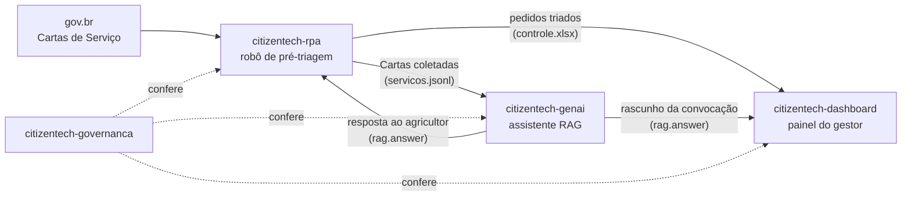

# CitizenTech: governança de IA e Business Analytics

Global Solution 2026.2 · FIAP · Governança em IA e Business Analytics · Turma 2TIAPF

Este repositório reúne a governança dos três módulos do CitizenTech, a solução que ajuda o agricultor
familiar do semiárido atingido pela seca a acessar serviços públicos (Garantia-Safra, CAF, Pronaf,
benefícios rurais). Aqui ficam os documentos de governança e os scripts que verificam, sobre o código
entregue, se cada módulo cumpre o que esses documentos prometem.

## Integrantes

| Nome completo | RM |
|---|---|
| Luís Fernando de Oliveira Salgado | RM561401 |
| Ricardo de Paiva Melo | RM565522 |
| Jonas Alaf | RM566479 |

## Como os quatro repositórios se conectam

O CitizenTech é uma solução só, dividida em quatro repositórios da organização
[citizentech-fiap](https://github.com/citizentech-fiap), um por disciplina. **Cada módulo roda sozinho**, com dados
de exemplo já versionados. Juntos, eles trocam dados assim:



| Repositório | Disciplina | O que faz | Precisa dos outros? |
|---|---|---|---|
| [`citizentech-rpa`](https://github.com/citizentech-fiap/citizentech-rpa) | AI for RPA | coleta as Cartas de Serviço do gov.br e faz a pré-triagem dos pedidos | não; com o genAI ao lado, redige as respostas com o assistente (sem ele, usa template) |
| [`citizentech-genai`](https://github.com/citizentech-fiap/citizentech-genai) | Generative AI | assistente que responde citando as Cartas de Serviço | não; traz uma cópia do corpus coletado pelo robô |
| [`citizentech-dashboard`](https://github.com/citizentech-fiap/citizentech-dashboard) | Front-end | painel de decisão do gestor (Mandacaru) | não; com genAI e RPA ao lado, usa o assistente e os pedidos do robô (sem eles, snapshots e templates) |
| [`citizentech-governanca`](https://github.com/citizentech-fiap/citizentech-governanca) **(este)** | Governança em IA | documentos e scripts que verificam os três módulos | **sim**: os três clonados ao lado |

**Para integrar, o nome das pastas importa.** Os módulos se encontram por caminhos relativos (`../genAI`, `../RPA`,
`../dashboard`). Um `git clone` sem nome de pasta cria `citizentech-genai`, e a integração não encontra o módulo.
Os comandos da seção [Rodar os quatro juntos](#rodar-os-quatro-juntos) já usam os nomes certos.

A versão de cada módulo coberta por esta governança (o commit exato) está em [`versoes.yaml`](versoes.yaml).

## Resultado atual

| Módulo | Risco | Metric Contract | Gate de promoção |
|---|---|---|---|
| RPA | alto | [MC-02](artefatos/metric_contracts/MC-02.yaml): decisão correta 83,3%, erro grave 0 | aprovado com exceção [EX-02](artefatos/excecoes.yaml) |
| GenAI | limitado | [MC-01](artefatos/metric_contracts/MC-01.yaml): 22 de 22 corretas no teste, 6 de 6 na validação | aprovado |
| Dashboard | alto | [MC-03](artefatos/metric_contracts/MC-03.yaml): acerto de 63,0% contra o IBGE, sensibilidade de 51,2% (alerta) | aprovado com exceção [EX-01](artefatos/excecoes.yaml) |

Detalhe em [`evidencias/gate.md`](evidencias/gate.md) e [`evidencias/metricas.md`](evidencias/metricas.md).

## Rodar os quatro juntos

Este repositório **não roda sozinho**: os scripts conferem o código dos três módulos, então os quatro precisam
estar clonados lado a lado, com os nomes de pasta abaixo.

Para a integração completa, os quatro repositórios ficam lado a lado numa mesma pasta e usam **um único ambiente
Python, na pasta de cima**. Assim, o robô e o painel enxergam o pacote do assistente, e a governança roda os testes
dos três com o mesmo Python.

```
CitizenTech/
├── .venv/        ambiente compartilhado pelos quatro
├── RPA/
├── genAI/
├── dashboard/
└── governanca/
```

**Windows (PowerShell)**
```powershell
mkdir CitizenTech; cd CitizenTech
git clone https://github.com/citizentech-fiap/citizentech-rpa.git RPA
git clone https://github.com/citizentech-fiap/citizentech-genai.git genAI
git clone https://github.com/citizentech-fiap/citizentech-dashboard.git dashboard
git clone https://github.com/citizentech-fiap/citizentech-governanca.git governanca
python -m venv .venv
.venv\Scripts\Activate.ps1
pip install -e genAI -r RPA/requirements.txt -r dashboard/requirements.txt -r governanca/requirements.txt
copy genAI\.env.example genAI\.env      # opcional: preencha GEMINI_API_KEY
```

**macOS / Linux**
```bash
mkdir CitizenTech && cd CitizenTech
git clone https://github.com/citizentech-fiap/citizentech-rpa.git RPA
git clone https://github.com/citizentech-fiap/citizentech-genai.git genAI
git clone https://github.com/citizentech-fiap/citizentech-dashboard.git dashboard
git clone https://github.com/citizentech-fiap/citizentech-governanca.git governanca
python3 -m venv .venv
source .venv/bin/activate
pip install torch --index-url https://download.pytorch.org/whl/cpu   # só no Linux: evita baixar vários GB de CUDA
pip install -e genAI -r RPA/requirements.txt -r dashboard/requirements.txt -r governanca/requirements.txt
cp genAI/.env.example genAI/.env        # opcional: preencha GEMINI_API_KEY
```

Com o ambiente ativado, cada módulo roda de dentro da própria pasta:

| Para | Comando |
|---|---|
| Portal do robô (enviar pedido, painel do robô, chat do assistente) | `cd RPA` → `streamlit run app/streamlit_app.py` |
| Painel do gestor | `cd dashboard` → `streamlit run app.py` |
| Gate de governança (roda as três suítes de teste) | `cd governanca` → `python scripts/gate.py` |

A chave do Gemini é gratuita em https://aistudio.google.com/apikey. Ela fica no `.env` do genAI (o assistente também
lê o `.env` do RPA). O `.env` está no `.gitignore` e não vai para o repositório. Sem chave, tudo funciona: o
assistente se abstém, e o robô e o painel usam textos prontos.

### Scripts da governança

Dentro de `governanca/`, nenhum script usa rede ou chave de API:

| Comando | O que faz | Saída |
|---|---|---|
| `python scripts/golden.py` | confere o hash dos conjuntos de referência | terminal |
| `python scripts/metricas.py` | recalcula os três Metric Contracts e dispara alertas | `evidencias/metricas.md` |
| `python scripts/subgrupos.py` | acerto por UF no painel; decisão por UF e serviço no robô | `evidencias/subgrupos.md` |
| `python scripts/drift.py` | PSI da chuva por safra ao lado do acerto do painel | `evidencias/drift.md` |
| `python scripts/ponte_series.py` | perda estimada antes e depois do RFC-03 | `evidencias/rfc03_ponte_series.md` |
| `python scripts/gate.py` | oito critérios por módulo, incluindo as suítes de teste dos três | `evidencias/gate.md` |
| `python -m unittest discover -s tests -q` | testes dos próprios scripts | terminal |

Com o ambiente ativado, rode de dentro de `governanca/`.

### O que você deve ver

- `python scripts/golden.py`: uma linha `igual` para cada arquivo de referência dos três módulos (o hash confere).
- `python scripts/gate.py`: leva alguns minutos, porque roda as suítes de teste dos três módulos (184 testes). No
  fim, o terminal mostra os 8 critérios de cada módulo, e o resultado é gravado em `evidencias/gate.md`: **genai
  aprovado**, **rpa e dashboard aprovados com exceção** (equidade, com responsável e prazo em
  [`artefatos/excecoes.yaml`](artefatos/excecoes.yaml)).
- `python scripts/gate.py --sem-testes`: a versão rápida. Pula as suítes, mostra os critérios só no terminal e não
  altera o `gate.md`.

**Se o gate recusar:** ele só gera evidência se cada módulo estiver **exatamente** no commit registrado em
[`versoes.yaml`](versoes.yaml) e sem alteração local. Isso é proposital: a evidência precisa se referir ao código
entregue. Se você clonou uma versão mais nova de algum módulo, faça `git checkout <commit>` com o commit do
`versoes.yaml` dentro da pasta dele.

## Mapa dos artefatos

| Conteúdo da disciplina | Arquivo |
|---|---|
| Classificação de risco (EU AI Act, PL 2.338/2023) | [`artefatos/classificacao_risco.md`](artefatos/classificacao_risco.md) |
| Papéis e RACI | [`artefatos/raci.md`](artefatos/raci.md) |
| NIST AI RMF aplicado | [`artefatos/nist_ai_rmf.md`](artefatos/nist_ai_rmf.md) |
| Linhagem dos dados e integração | [`artefatos/linhagem.md`](artefatos/linhagem.md) |
| Model Cards | [`artefatos/model_cards/`](artefatos/model_cards/) |
| Metric Contracts (modelo da disciplina e YAML executável) | [`artefatos/metric_contracts/`](artefatos/metric_contracts/) |
| RFCs com ponte entre séries | [`artefatos/rfc/`](artefatos/rfc/) |
| Gate de promoção e exceções | [`artefatos/checklists/gate_promocao.md`](artefatos/checklists/gate_promocao.md), [`artefatos/excecoes.yaml`](artefatos/excecoes.yaml) |
| Plano de monitoramento | [`artefatos/plano_monitoramento.md`](artefatos/plano_monitoramento.md) |
| Checklists de ética, equidade e LGPD | [`artefatos/checklists/`](artefatos/checklists/) |
| LGPD: inventário, RIPD e termo de consentimento | [`artefatos/lgpd/`](artefatos/lgpd/) |
| Maturidade (DAMA-DMBOK2, MLOps) e roadmap | [`artefatos/maturidade_roadmap.md`](artefatos/maturidade_roadmap.md) |
| Antipadrões evitados e presentes | [`artefatos/antipadroes.md`](artefatos/antipadroes.md) |
| Disciplinas da GS não integradas e motivo | [`artefatos/disciplinas_nao_integradas.md`](artefatos/disciplinas_nao_integradas.md) |

## Relatório

[`relatorio/CitizenTech_Governanca.docx`](relatorio/CitizenTech_Governanca.docx), no formato ABNT. Ao abrir no
Word, aceite a atualização dos campos para montar o sumário e as listas de figuras e quadros.

## Links

- RPA: https://github.com/citizentech-fiap/citizentech-rpa
- GenAI: https://github.com/citizentech-fiap/citizentech-genai
- Dashboard: https://github.com/citizentech-fiap/citizentech-dashboard

## Licença

MIT. Ver [`LICENSE`](LICENSE).
