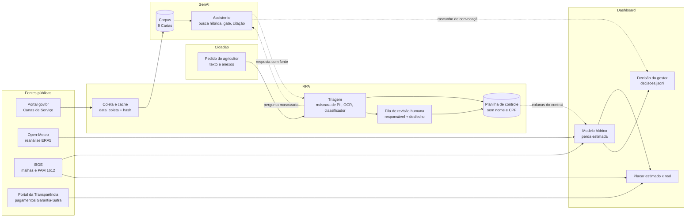

# Linhagem dos dados e integração dos módulos

O diagrama mostra de onde vem cada dado, por quais módulos passa e onde termina. As setas tracejadas são
integrações opcionais, que têm volta automática para um caminho sem IA quando falham.

## Pontos de controle na linhagem

| Ponto | Controle | Onde está |
|---|---|---|
| Coleta das Cartas | data de coleta, origem (api, html ou cache) e hash do conteúdo por carta | `RPA/robo/collector.py`, `genAI/data/corpus/FONTES.md` |
| Entrada do pedido | máscara de CPF, e-mail, telefone e RG antes do classificador e antes do assistente | `RPA/robo/privacy.py`, `genAI/citizen_rag/guardrails.py` |
| Planilha de controle | só identificador do pedido, serviço, decisão e município; sem nome nem CPF | `RPA/robo/outputs.py`, `RPA/CONTRACTS.md` |
| Painel lendo o robô | seleção explícita das colunas do contrato | `dashboard/providers/rpa.py` |
| Pagamentos da CGU | arquivo lido em memória; nome do favorecido nunca carregado; NIS usado só para contar famílias | `dashboard/providers/transparencia.py` |
| Decisão do gestor | registro só de acréscimo, com identificação, data e motivo | `dashboard/pipelines/decisoes.py` |
| Versão de cada módulo | commit registrado e conjuntos de referência com hash | `versoes.yaml`, `golden/hashes.json` |

## Lacunas

- Os módulos se encontram por caminho relativo (`../genAI`, `../RPA`). A versão usada por cada um só fica
  registrada aqui, em `versoes.yaml`, e não dentro dos próprios módulos.
- O painel não lê a aba de revisão humana do robô. O desfecho dado pelo atendente não volta para o gestor.
- A trilha de decisões do painel é um arquivo local, sem assinatura nem autenticação do gestor.
